# Assist 시리즈 로드맵

Made by seolwoni · 싱글플레이와 본인 서버용 생존 자동화 시리즈 (Fabric 26.2)

## 구조
- **각 모드**: 무엇을, 어디서, 어떤 순서로 할지 정해요.
- **Assist Path** (예정, Baritone 기반, LGPL): 어떤 길로 갈지 계산해요.
- **Assist Core**: 사람처럼 실제로 움직여요 (시선, 회전, 걷기, 캐기, 놓기, 작업 큐, 상자, HUD, 설정).

흐름: Mine · Lumber · Farm · Ranch가 모으고 → Sort가 정리하고 → Smelt가 굽고 → Quarry가 땅을 고르고 → Build가 지어요. Travel은 모두를 멀리까지 이동시키고, Gear는 모두의 장비를 관리해요.

## 완성
| 아이콘 | 모드 | 하는 일 |
|---|---|---|
| 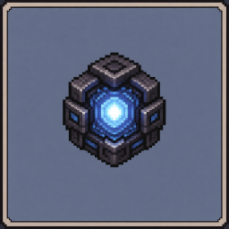 | Assist Core | 공용 기반 |
| 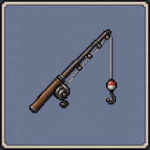 | Reel Assist | 낚시 |
| 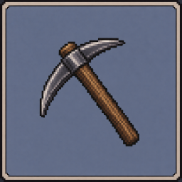 | Mine Assist | 가지굴 채광 |
| 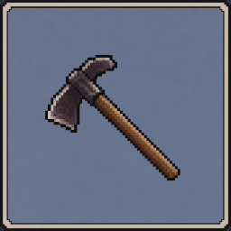 | Farm Assist | 농사 |
| 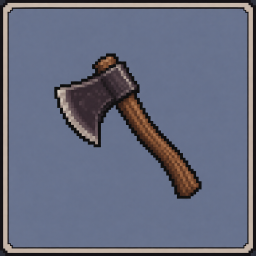 | Lumber Assist | 벌목 |

## 다음 순서
| 순서 | 아이콘 | 모드 | 하는 일 |
|---|---|---|---|
| 1 | 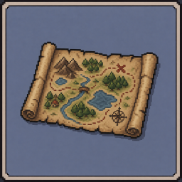 | Assist Path | 길찾기 (경로 탐색, 이동 종류, 위험 회피, 지형 기억) |
| 2 | 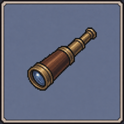 | Travel Assist | 좌표·웨이포인트까지 이동 |
| 3 | 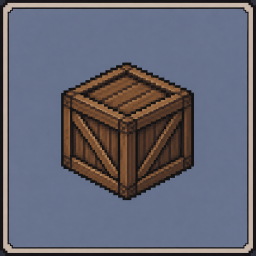 | Sort Assist | 창고 자동 정리, 모드끼리 연결하는 중심 |
| 4 | 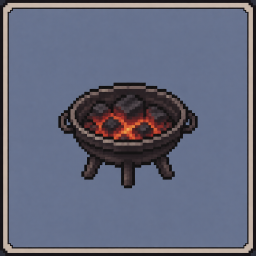 | Smelt Assist | 화로 굽기, 숯·판자 만들기 |
| 5 | 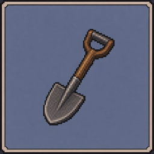 | Quarry Assist | 구역 통째로 파기·평탄화 |
| 6 | 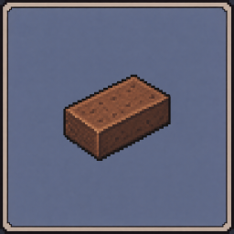 | Build Assist | 설계도·단순 모양 자동 건축 |
| 7 | 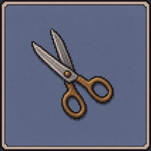 | Ranch Assist | 동물 번식, 양털·우유·달걀 |
| 8 | 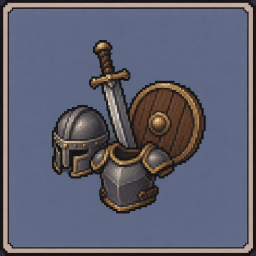 | Gear Assist | 장비 내구도 관리와 교체 |

함께 진행: 사람 같은 엔진 고도화 (미리 보기, 지나쳤다 돌아오기, 피로감, 작은 실수, 매번 다른 경로).

## 후순위 · 후보
- Trade Assist: 주민 거래 반복, 인챈트북 찾기
- Mob Assist: 몹 농장 사냥, 경험치 모으기
- Brew Assist: 양조기 포션 반복 제작
- Enchant Assist: 원하는 인챈트까지 반복, 숫돌·모루 정리
- Explore Assist: 웨이포인트, 사망 위치, 지도 HUD

## 원칙
- 싱글플레이와 본인 서버용. 매크로가 금지된 서버의 단속을 피하는 기능은 만들지 않아요.
- 벽 너머를 보는 기능(X-ray)은 넣지 않아요.
- 지형 정보는 길 계획(Assist Path)에만 써요. 보이지 않는 광석·상자 같은 목표를 찾는 데는 쓰지 않아요. 나중에 '본 곳 위주로 길 찾기' 설정을 따로 둘 수 있어요.
- 모든 버전은 GitHub에서 실제 게임을 띄우는 자동 테스트를 통과해야 릴리스돼요.
